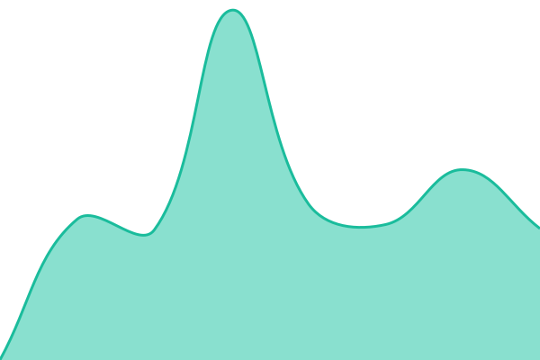
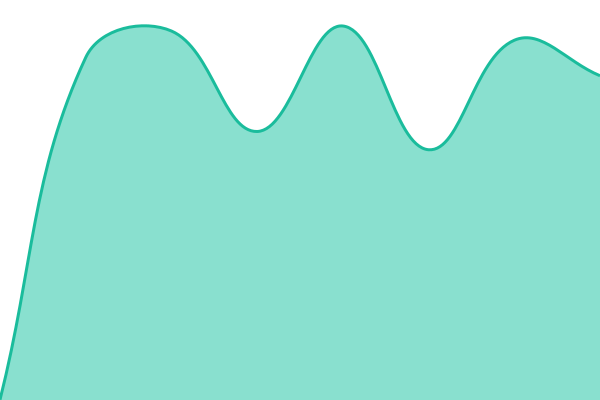
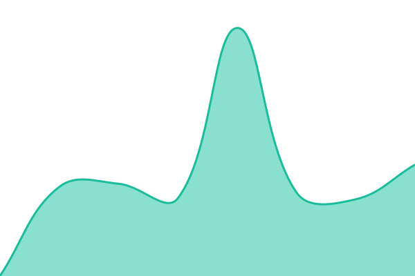
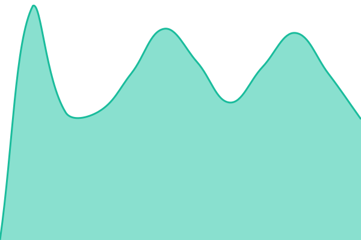
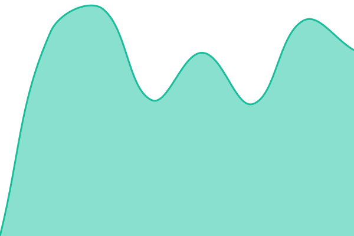

# [📈 Live Status](https://datacomp-it.github.io/monitoring): <!--live status--> **🟩 All systems operational**

This repository contains the open-source uptime monitor and status page for [datacomp-it](https://datacomp-it.github.io/monitoring), powered by [Upptime](https://github.com/upptime/upptime).

With [Upptime](https://upptime.js.org), you can get your own unlimited and free uptime monitor and status page, powered entirely by a GitHub repository. We use [Issues](https://github.com/datacomp-it/monitoring/issues) as incident reports, [Actions](https://github.com/datacomp-it/monitoring/actions) as uptime monitors, and [Pages](https://datacomp-it.github.io/monitoring) for the status page.

<!--start: status pages-->
<!-- This summary is generated by Upptime (https://github.com/upptime/upptime) -->
<!-- Do not edit this manually, your changes will be overwritten -->
<!-- prettier-ignore -->
| URL | Status | History | Response Time | Uptime |
| --- | ------ | ------- | ------------- | ------ |
|  [DataComp Cloud - Flow](https://flow.datacomp-cloud.eu/) | 🟩 Up | [data-comp-cloud-flow.yml](https://github.com/datacomp-it/monitoring/commits/HEAD/history/data-comp-cloud-flow.yml) | 

 670ms
     
 | 

<a href="https://datacomp-it.github.io/monitoring/history/data-comp-cloud-flow">100.00%</a>
    

|  [DataComp Cloud - Lab](https://lab.datacomp-cloud.eu/) | 🟩 Up | [data-comp-cloud-lab.yml](https://github.com/datacomp-it/monitoring/commits/HEAD/history/data-comp-cloud-lab.yml) | 

 3465ms
     
 | 

<a href="https://datacomp-it.github.io/monitoring/history/data-comp-cloud-lab">100.00%</a>
    

|  [DataComp Cloud - Newsletter](https://newsletter.datacomp-cloud.eu/s/dashboard) | 🟩 Up | [data-comp-cloud-newsletter.yml](https://github.com/datacomp-it/monitoring/commits/HEAD/history/data-comp-cloud-newsletter.yml) | 

 1491ms
     
 | 

<a href="https://datacomp-it.github.io/monitoring/history/data-comp-cloud-newsletter">100.00%</a>
    

|  [DataComp Cloud - Chatwoot](https://chat.datacomp-cloud.eu/) | 🟩 Up | [data-comp-cloud-chatwoot.yml](https://github.com/datacomp-it/monitoring/commits/HEAD/history/data-comp-cloud-chatwoot.yml) | 

 897ms
     
 | 

<a href="https://datacomp-it.github.io/monitoring/history/data-comp-cloud-chatwoot">100.00%</a>
    

|  [DataComp Cloud - Watercrawl](https://wtr.datacomp-cloud.eu/) | 🟩 Up | [data-comp-cloud-watercrawl.yml](https://github.com/datacomp-it/monitoring/commits/HEAD/history/data-comp-cloud-watercrawl.yml) | 

 685ms
     
 | 

<a href="https://datacomp-it.github.io/monitoring/history/data-comp-cloud-watercrawl">100.00%</a>
    

|  [alibre.pl](https://alibre.pl/) | 🟩 Up | [alibre-pl.yml](https://github.com/datacomp-it/monitoring/commits/HEAD/history/alibre-pl.yml) | 

 1533ms
     
 | 

<a href="https://datacomp-it.github.io/monitoring/history/alibre-pl">100.00%</a>
    

|  [bim4u.eu](https://bim4u.eu/) | 🟩 Up | [bim4u-eu.yml](https://github.com/datacomp-it/monitoring/commits/HEAD/history/bim4u-eu.yml) | 

 1439ms
     
 | 

<a href="https://datacomp-it.github.io/monitoring/history/bim4u-eu">100.00%</a>
    

|  [bimestimate.eu](https://bimestimate.eu/) | 🟩 Up | [bimestimate-eu.yml](https://github.com/datacomp-it/monitoring/commits/HEAD/history/bimestimate-eu.yml) | 

 2370ms
     
 | 

<a href="https://datacomp-it.github.io/monitoring/history/bimestimate-eu">100.00%</a>
    

|  [bimvision.eu](https://bimvision.eu/) | 🟩 Up | [bimvision-eu.yml](https://github.com/datacomp-it/monitoring/commits/HEAD/history/bimvision-eu.yml) | 

 2006ms
     
 | 

<a href="https://datacomp-it.github.io/monitoring/history/bimvision-eu">100.00%</a>
    

|  [datacomp.com.pl](https://datacomp.com.pl/) | 🟩 Up | [datacomp-com-pl.yml](https://github.com/datacomp-it/monitoring/commits/HEAD/history/datacomp-com-pl.yml) | 

 1312ms
     
 | 

<a href="https://datacomp-it.github.io/monitoring/history/datacomp-com-pl">100.00%</a>
    

|  [dds-cad.pl](https://dds-cad.pl/) | 🟩 Up | [dds-cad-pl.yml](https://github.com/datacomp-it/monitoring/commits/HEAD/history/dds-cad-pl.yml) | 

 1350ms
     
 | 

<a href="https://datacomp-it.github.io/monitoring/history/dds-cad-pl">100.00%</a>
    

|  [ezcam.pl](https://ezcam.pl/) | 🟩 Up | [ezcam-pl.yml](https://github.com/datacomp-it/monitoring/commits/HEAD/history/ezcam-pl.yml) | 

 1267ms
     
 | 

<a href="https://datacomp-it.github.io/monitoring/history/ezcam-pl">100.00%</a>
    

|  [ffbud.datacomp.com.pl](https://ffbud.datacomp.com.pl/) | 🟩 Up | [ffbud-datacomp-com-pl.yml](https://github.com/datacomp-it/monitoring/commits/HEAD/history/ffbud-datacomp-com-pl.yml) | 

 2400ms
     
 | 

<a href="https://datacomp-it.github.io/monitoring/history/ffbud-datacomp-com-pl">100.00%</a>
    

|  [fluidflow.pl](https://fluidflow.pl/) | 🟩 Up | [fluidflow-pl.yml](https://github.com/datacomp-it/monitoring/commits/HEAD/history/fluidflow-pl.yml) | 

 1248ms
     
 | 

<a href="https://datacomp-it.github.io/monitoring/history/fluidflow-pl">100.00%</a>
    

|  [helpcenter.bimvision.eu](https://helpcenter.bimvision.eu/) | 🟩 Up | [helpcenter-bimvision-eu.yml](https://github.com/datacomp-it/monitoring/commits/HEAD/history/helpcenter-bimvision-eu.yml) | 

 1635ms
     
 | 

<a href="https://datacomp-it.github.io/monitoring/history/helpcenter-bimvision-eu">100.00%</a>
    

|  [4MCAD](https://4mcad.pl/) | 🟩 Up | [4-mcad.yml](https://github.com/datacomp-it/monitoring/commits/HEAD/history/4-mcad.yml) | 

 1415ms
     
 | 

<a href="https://datacomp-it.github.io/monitoring/history/4-mcad">100.00%</a>
    

|  [keyshot.datacomp.com.pl](https://keyshot.datacomp.com.pl/) | 🟩 Up | [keyshot-datacomp-com-pl.yml](https://github.com/datacomp-it/monitoring/commits/HEAD/history/keyshot-datacomp-com-pl.yml) | 

 1862ms
     
 | 

<a href="https://datacomp-it.github.io/monitoring/history/keyshot-datacomp-com-pl">100.00%</a>
    

|  [m-files.datacomp.com.pl](https://m-files.datacomp.com.pl/) | 🟩 Up | [m-files-datacomp-com-pl.yml](https://github.com/datacomp-it/monitoring/commits/HEAD/history/m-files-datacomp-com-pl.yml) | 

 1116ms
     
 | 

<a href="https://datacomp-it.github.io/monitoring/history/m-files-datacomp-com-pl">100.00%</a>
    

|  [outsourcing.datacomp.com.pl](https://outsourcing.datacomp.com.pl/) | 🟩 Up | [outsourcing-datacomp-com-pl.yml](https://github.com/datacomp-it/monitoring/commits/HEAD/history/outsourcing-datacomp-com-pl.yml) | 

 1228ms
     
 | 

<a href="https://datacomp-it.github.io/monitoring/history/outsourcing-datacomp-com-pl">100.00%</a>
    

|  [projektowanie-drog.pl](https://projektowanie-drog.pl/) | 🟩 Up | [projektowanie-drog-pl.yml](https://github.com/datacomp-it/monitoring/commits/HEAD/history/projektowanie-drog-pl.yml) | 

 1272ms
     
 | 

<a href="https://datacomp-it.github.io/monitoring/history/projektowanie-drog-pl">100.00%</a>
    

|  [projektowanie-rurociagow.pl](https://projektowanie-rurociagow.pl/) | 🟩 Up | [projektowanie-rurociagow-pl.yml](https://github.com/datacomp-it/monitoring/commits/HEAD/history/projektowanie-rurociagow-pl.yml) | 

 1200ms
     
 | 

<a href="https://datacomp-it.github.io/monitoring/history/projektowanie-rurociagow-pl">100.00%</a>
    

|  [projektowaniecad.com.pl](https://projektowaniecad.com.pl/) | 🟩 Up | [projektowaniecad-com-pl.yml](https://github.com/datacomp-it/monitoring/commits/HEAD/history/projektowaniecad-com-pl.yml) | 

 2180ms
     
 | 

<a href="https://datacomp-it.github.io/monitoring/history/projektowaniecad-com-pl">100.00%</a>
    

|  [propublico.pl](https://propublico.pl/) | 🟩 Up | [propublico-pl.yml](https://github.com/datacomp-it/monitoring/commits/HEAD/history/propublico-pl.yml) | 

 1894ms
     
 | 

<a href="https://datacomp-it.github.io/monitoring/history/propublico-pl">100.00%</a>
    

|  [sklep.datacomp.com.pl](https://sklep.datacomp.com.pl/) | 🟩 Up | [sklep-datacomp-com-pl.yml](https://github.com/datacomp-it/monitoring/commits/HEAD/history/sklep-datacomp-com-pl.yml) | 

 1175ms
     
 | 

<a href="https://datacomp-it.github.io/monitoring/history/sklep-datacomp-com-pl">100.00%</a>
    

|  [stalowekonstrukcje.com.pl](https://stalowekonstrukcje.com.pl/) | 🟩 Up | [stalowekonstrukcje-com-pl.yml](https://github.com/datacomp-it/monitoring/commits/HEAD/history/stalowekonstrukcje-com-pl.yml) | 

 1087ms
     
 | 

<a href="https://datacomp-it.github.io/monitoring/history/stalowekonstrukcje-com-pl">100.00%</a>
    

|  [visualmill.pl](https://visualmill.pl/) | 🟩 Up | [visualmill-pl.yml](https://github.com/datacomp-it/monitoring/commits/HEAD/history/visualmill-pl.yml) | 

 1620ms
     
 | 

<a href="https://datacomp-it.github.io/monitoring/history/visualmill-pl">100.00%</a>
    

|  [wizualizacje.pro](https://wizualizacje.pro/) | 🟩 Up | [wizualizacje-pro.yml](https://github.com/datacomp-it/monitoring/commits/HEAD/history/wizualizacje-pro.yml) | 

 1179ms
     
 | 

<a href="https://datacomp-it.github.io/monitoring/history/wizualizacje-pro">100.00%</a>
    

|  [zelbetpro.pl](https://zelbetpro.pl/) | 🟩 Up | [zelbetpro-pl.yml](https://github.com/datacomp-it/monitoring/commits/HEAD/history/zelbetpro-pl.yml) | 

 1117ms
     
 | 

<a href="https://datacomp-it.github.io/monitoring/history/zelbetpro-pl">100.00%</a>
    

<!--end: status pages-->

[**Visit our status website →**](https://datacomp-it.github.io/monitoring)

## 📄 License

- Powered by: [Upptime](https://github.com/upptime/upptime)
- Code: [MIT](./LICENSE) © [Anand Chowdhary](https://anandchowdhary.com)
- Data in the `./history` directory: [Open Database License](https://opendatacommons.org/licenses/odbl/1-0/)
